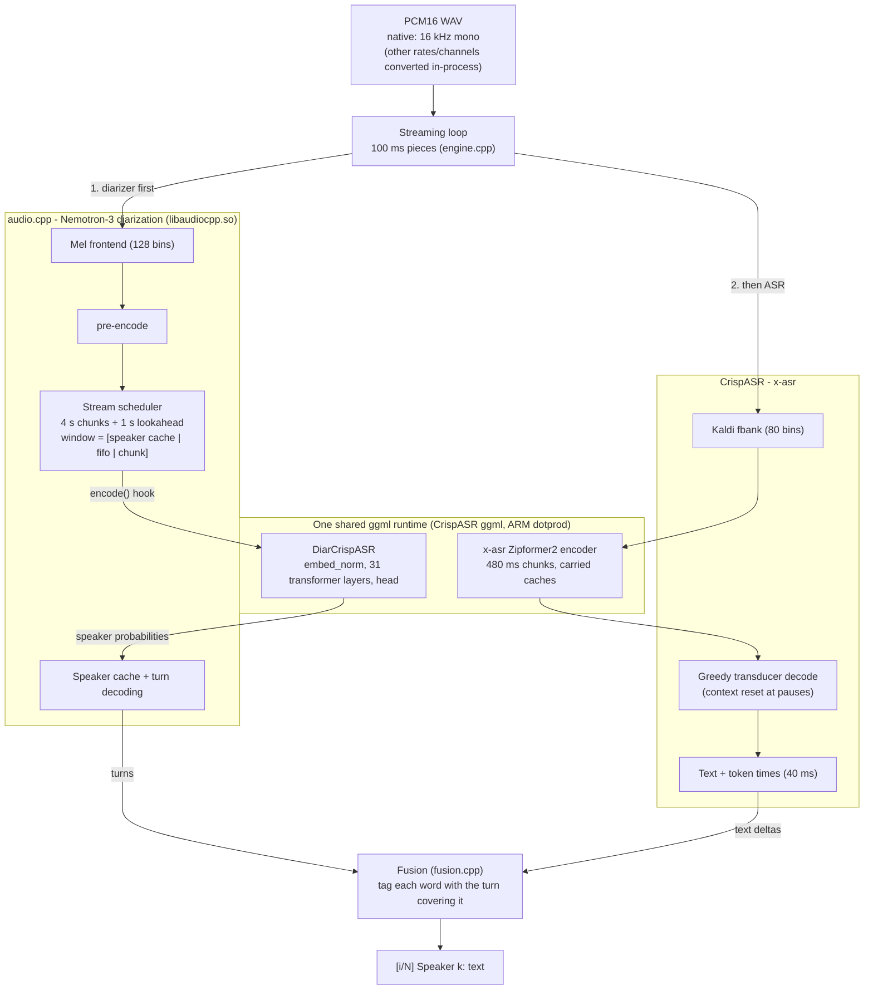

# nemo-x-asr-diarizer.cpp (LiteRT branch)

Streaming speech recognition and speaker diarization in one process, on one audio timeline.

- **Words:** [X-ASR](https://huggingface.co/cstr/x-asr-zh-en-GGUF), a streaming Zipformer2 transducer (zh + en).
- **Speakers:** Nemotron-3 Diarization (streaming Sortformer, up to 8 speakers).
- **Fusion:** a small attribution layer that tags each word with who said it.

This branch ports both neural graphs to **LiteRT** (dynamic int8) and compares them with the ggml build.
Everything else (fbank, decoder, joiner, scheduler, fusion) is shared. The ggml path stays the default.

## LiteRT port: result

Both graphs now run on LiteRT behind `--backend litert_cpu`:

- **X-ASR streaming encoder** (480 ms chunks, 116 carried state tensors): `xasr_stream_q8_octav.tflite`,
  153 MB, dynamic int8 with OCTAV. Exported from the trainable torch checkpoint; a CrispASR chunk hook
  (`patches/crispasr-chunk-hook.patch`) replaces the ggml graph compute.
- **Sortformer diarizer** (encoder and head, F_max 190): `sortformer_int8_f190.tflite`, 101 MB, dynamic int8.

### Equivalence checks

| Check | Result |
|---|---|
| X-ASR fp32 LiteRT vs torch (10 chunks) | max abs diff 4.9e-6 |
| X-ASR torch streaming vs chunk-480ms ONNX | 2.4e-6 |
| X-ASR ASR-only, 60 s clip | transcript identical to ggml, word for word (194 words) |
| Diarizer int8 LiteRT vs ggml q8, 16 real windows | 99.95 % of frame×speaker decisions agree |
| Diarizer fp32 LiteRT vs torch | max abs diff 5.7e-6 |

## LiteRT vs ggml: comparison (EN2002a excerpt, 600 s, host CPU)

| | ggml q8 | LiteRT int8 | difference |
|---|---|---|---|
| Peak RSS | 517 MB | 728 MB | LiteRT +211 MB |
| RTF (ASR + diar) | 0.25 | 0.11 | LiteRT about 2.3x faster |
| DER, collar 0.25, [120, 720) s | 18.66 % | 19.08 % | +0.42 pt |
| Speaker turns / speakers | 430 / 4 | 486 / 4 | same speaker count |
| ASR-only transcript similarity (600 s) | reference | 98.1 % (word level) | small deletions and substitutions |
| Full transcript, labels and punctuation removed | reference | 99.0 % | |

**Reading the comparison.**

- **Accuracy:** on this clip the two backends are close (0.4 DER point). The ASR transcripts are identical
  on 60 s and differ by small word-level edits over 600 s, which is consistent with int8 quantization in the
  encoder.
- **Likely source of the DER gap:** the diarizer int8 weights. An earlier host run on the same clip gave
  LiteRT fp32 17.88 % against ggml 17.80 %, and int8 19.87 %. The fp32 full-pipeline DER has not been measured
  yet, so this is not isolated.
- **Cost:** LiteRT uses more memory here and is faster on this CPU. The GPU backend, Android and iOS are not
  measured yet.

Not yet done: GPU backend (ML Drift), Android (Note10+) and iOS (iPhone 14 Pro Max) benchmarks, a second
evaluation clip (AMI or AISHELL-4), and the fp32 full-pipeline DER. Details in [docs/LITERT.md](docs/LITERT.md).

## Build and run (host)

```bash
scripts/fetch_models.sh        # ggml GGUFs for the reference path, verified
LITERT_SO_DIR=<dir with libLiteRt.so> LITERT_INC_DIR=<litert headers> ALLOW_DEPS_DRIFT=1 scripts/build_host.sh

# LiteRT
./build/nemo-x-asr-diarizer --audio clip.wav --backend litert_cpu \
    --xasr-tflite xasr_stream_q8_octav.tflite --diar-tflite sortformer_int8_f190.tflite \
    --xasr-model models/x-asr-zh-en-q8_0.gguf

# ggml (default)
./build/nemo-x-asr-diarizer --audio clip.wav --json --turns-out turns.json
```

The LiteRT `.tflite` files are not published; `tools/litert-export/` contains the export and quantization
scripts. Speaker turns and transcripts are the same format on both backends.


## Architecture



Both models' heavy compute runs on one ggml runtime by default. With `--backend litert_cpu` the X-ASR encoder and the diarizer encoder/head run as LiteRT int8 graphs instead; mel, decoder, joiner, scheduler and fusion are unchanged ([docs/LITERT.md](docs/LITERT.md)). The diarizer's encoder and head were ported from
audio.cpp into `src/diar_crispasr.cpp`. The port is bit-exact with audio.cpp's own path and ~1% faster
([docs/one-runtime-merge.md](docs/one-runtime-merge.md) §25-27). audio.cpp keeps the parts that are logic, not
compute: mel, pre-encode (0.05% of time), windowing, speaker cache and turn decoding.

## Models

| role | GGUF used (q8_0) | original weights | license |
|---|---|---|---|
| ASR | [cstr/x-asr-zh-en-GGUF](https://huggingface.co/cstr/x-asr-zh-en-GGUF) `x-asr-zh-en-q8_0.gguf` (168 MB) | [GilgameshWind/X-ASR-zh-en](https://huggingface.co/GilgameshWind/X-ASR-zh-en) | Apache-2.0 |
| diarization | [audio-cpp/Nemotron-3-Diarization-GGUF](https://huggingface.co/audio-cpp/Nemotron-3-Diarization-GGUF) `nemotron-3-diarization-q8_0.gguf` (107 MB) | [nvidia/Nemotron-3-Diarization](https://huggingface.co/nvidia/Nemotron-3-Diarization) | see model card |

`scripts/fetch_models.sh` downloads both and verifies them at value level.

LiteRT backend (`--backend litert_cpu`, branch `litert-port`): `xasr_stream_q8_octav.tflite` (153 MB, X-ASR streaming encoder, dynamic int8) and `sortformer_int8_f190.tflite` (101 MB, diarizer, dynamic int8, F_max 190). Not yet published; see [docs/LITERT.md](docs/LITERT.md) for how they are produced.

## Known limits

- **Speaker turns lag the words by ~5 s.** Text appears within ~0.4 s. Each speaker turn is confirmed once
  its 4 s diarizer chunk plus 1 s of lookahead is in, and `--live` labels before that are provisional. The
  latency is a setting: `--diar-session-opt nemotron_3_diar.chunk_len=25 ...chunk_right_context=4` gives
  ~2.4 s at RTF ~0.87, and `chunk_len=340 ...chunk_right_context=40 ...spkcache_update_period=300` gives
  30.5 s at RTF 0.42. The official `low` profile (~1 s) is not real time on 2 cores (RTF 3.4).
- **Diarization recall.** It misses 19% of speech frames on the 57 s bilingual clip and 7% on `gate_long`,
  with few false alarms (DER-lite 22.7% and 10.0%).
- **Some words are not transcribed.** These are overlapped speech (a single-stream ASR transcribes one voice
  at a time) and Chinese that follows English after a short pause. The latter comes from the x-asr model's
  own streaming state and would need retraining to fix
  ([docs/findings.md](docs/findings.md#missing-words-were-a-streaming-state-problem-not-diarization-2026-09-27)).
- **Two ggml libraries are still linked.** The CrispASR ggml fork cannot replace audio.cpp's (missing ops),
  so the unified runtime goes through audio.cpp's external-encoder hook instead.

## Docs

- [docs/findings.md](docs/findings.md): attribution, token timestamps, window format, diarizer knobs,
  phone findings, resampling, missing words
- [docs/one-runtime-merge.md](docs/one-runtime-merge.md): how the diarizer was moved onto the shared
  runtime, including the dead ends
- [docs/LITERT.md](docs/LITERT.md): LiteRT backend status, numbers and open items
- [docs/pipeline-design.md](docs/pipeline-design.md): performance work (dotprod, joint, KleidiAI, …)

## Provenance

[CrispASR](https://github.com/CrispStrobe/CrispASR) (MIT) for the x-asr runtime,
[audio.cpp](https://github.com/0xShug0/audio.cpp) (Apache-2.0) for Nemotron-3 diarization,
[ggml](https://github.com/ggml-org/ggml) (MIT) under both. See [PROVENANCE.md](PROVENANCE.md) for the
per-file list. Model weights carry their own licenses (`fetch_models.sh` prints them). This repository's
license covers the code here only.
